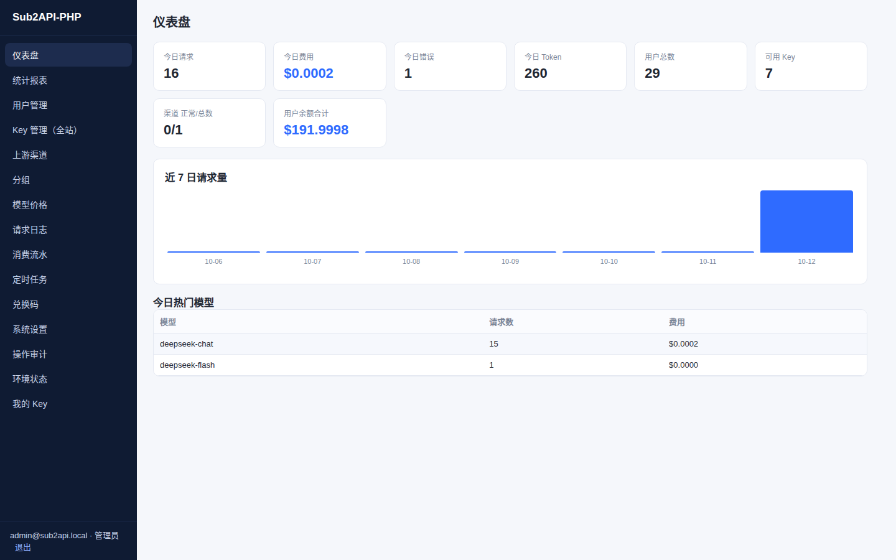
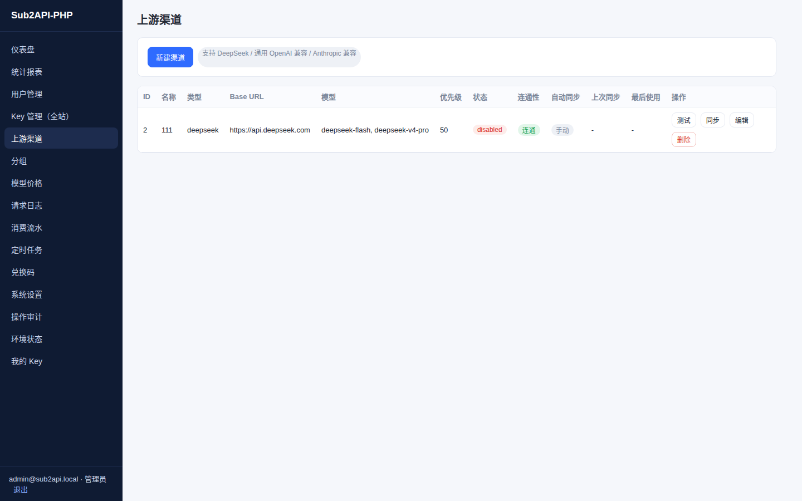
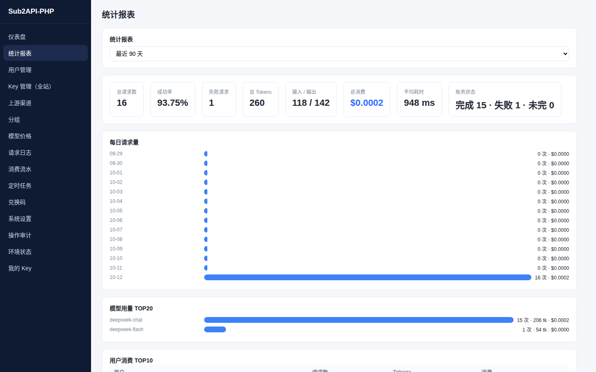
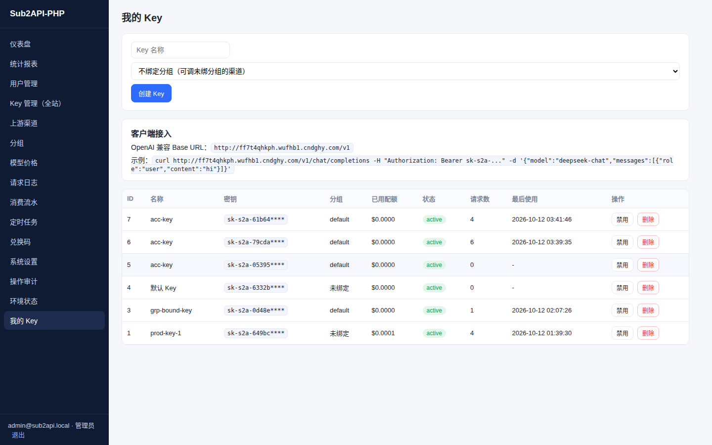
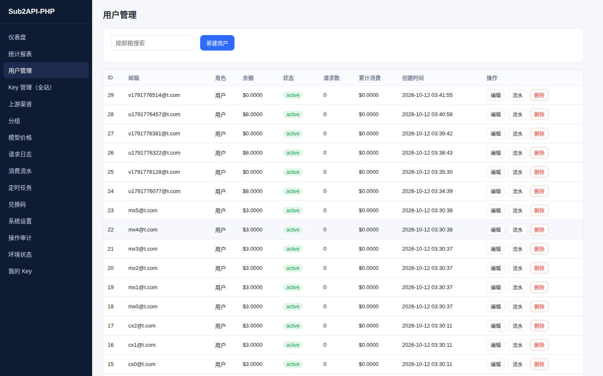
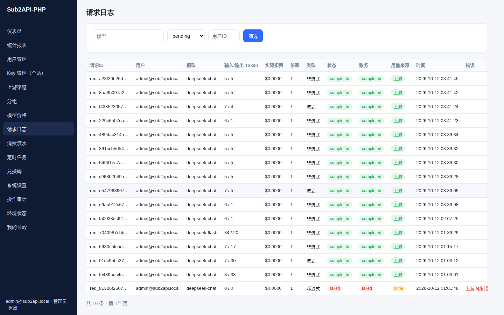
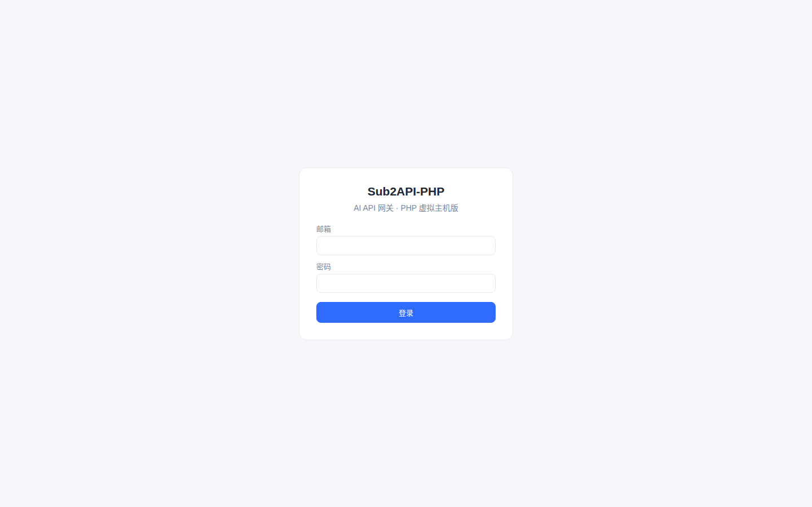

<div align="center">

# Sub2API-PHP

**AI API 网关 · PHP 虚拟主机版**

将任意 PHP 网站空间（无需 VPS / Docker / Redis / Node.js / Composer）变成一个带用户体系、计费系统和管理后台的 AI API 中转站。

基于 [Wei-Shaw/sub2api](https://github.com/Wei-Shaw/sub2api)（Go + PostgreSQL + Redis）的思路，用 **PHP 8.2+ / MySQL / SQLite** 全新重写，**零 Composer 依赖，上传即装**。

[](https://www.php.net/)
[](https://www.mysql.com/)
[](LICENSE)
[](docs/TEST_REPORT.md)

</div>

---

## ✨ 功能总览

| 模块 | 功能 |
|---|---|
| 🔌 **API 网关** | OpenAI 兼容协议（`/v1/models`、`/v1/chat/completions`）+ Anthropic Messages 协议（`/v1/messages`），非流式 / **SSE 流式**实时转发 |
| 🏭 **上游渠道** | DeepSeek 官方、通用 OpenAI 兼容、Anthropic 兼容；密钥 AES-256-GCM 加密存储；连通性测试、优先级、故障切换、多渠道轮询 |
| 🔄 **模型自动同步** | 一键拉取上游全部模型勾选添加；可设置定时自动同步周期；**同步只增不删**，避免厂商更新模型导致冲突 |
| 💰 **精确计费** | 优先采用上游真实 usage 计量；按模型配置价格（USD / 百万 Token）；分组倍率；余额事务保护、防重复扣费、请求级账务状态 |
| 👥 **用户体系** | 管理员/普通用户角色隔离、余额充值、消费流水、登录防爆破、CSRF 防护 |
| 🔑 **API Key** | 创建/禁用/启用/轮换；绑定分组（绑哪个分组就能用哪个分组的模型）；有效期、RPM 限流、额度上限；SHA-256 哈希存储 |
| 🗂 **分组** | 自由绑定上游渠道；分组价格倍率；渠道未绑分组时对所有分组开放 |
| 📊 **统计报表** | 仪表盘（今日请求/费用/Token/用户/Key）、按日/按模型/按用户/按 Key/按渠道多维统计、柱状图展示 |
| ⏰ **定时任务** | 渠道连通性检测、用量统计整理、日志清理、渠道模型同步；Cron 或安全外部触发 URL（带 Token 鉴权） |
| 🎫 **兑换码** | 批量生成、余额兑换 |
| 🛡 **安全** | PDO 参数化查询、XSS/CSRF 防护、SSRF 防护（禁止上游指向内网）、操作审计日志、密钥不明文落库不出前端 |
| 🧙 **一键安装** | 环境检测 → 数据库连接 → 建表迁移 → 创建管理员 → 测试上游 → 锁定安装器，全程中文向导 |

## 📸 界面截图

### 仪表盘


### 上游渠道管理


### 统计报表


### 我的 Key


### 用户管理


### 请求日志


### 登录页


## 🚀 部署指南

### 环境要求

| 项目 | 要求 |
|---|---|
| PHP | **8.2 及以上**，需扩展：`pdo_mysql`（或 `pdo_sqlite`）、`curl`、`openssl`、`json`、`mbstring` |
| 数据库 | MySQL 5.7+（推荐）或 SQLite 3 |
| Web 服务器 | Apache（自带 `.htaccess`）/ Nginx / IIS（自带 `web.config`） |
| 其他 | ❌ 不需要 Redis / Docker / Node.js / Composer / SSH |

> 💡 你只需要一个支持 PHP 8.2 + MySQL 的普通虚拟主机或服务器，和一份 FTP / 面板文件管理权限。

### 方式一：虚拟主机 / FTP 上传（最常见）

1. **下载** [sub2api-php-release.zip](../../releases) 并解压到本地；
2. 用 FTP / 主机面板把**全部文件上传**到网站根目录（如 `wwwroot` / `public_html`）；
3. 浏览器访问 `http://你的域名/`，自动进入安装向导；
4. 按向导依次完成：

   ```
   ① 环境检测（PHP 版本 / 扩展 / 目录写权限）
   ② 选择数据库：MySQL（填地址/库名/账号密码）或 SQLite
   ③ 数据库连接测试 → 自动创建全部数据表
   ④ 创建管理员账号（邮箱 + 密码）
   ⑤ 生成应用安全密钥（自动）
   ⑥ 配置第一个上游渠道（如 DeepSeek）并测试连通性
   ⑦ 初始化默认模型价格
   ⑧ 完成安装，安装器自动锁定
   ```

5. 登录后台 → **上游渠道** → 添加你的 DeepSeek / OpenAI 兼容 API Key → **测试**连通；
6. **我的 Key** → 新建一个 API Key（可绑定分组）→ 复制 `sk-` 开头的密钥即可调用。

### 方式二：宝塔 / 1Panel 等面板

1. 新建 PHP 8.2 站点 + MySQL 数据库；
2. 把 ZIP 上传到站点根目录解压（或把解压后的文件放入）；
3. 其余步骤同上（从第 3 步开始）。

### 方式三：本地 / 服务器 Nginx

```nginx
server {
    listen 80;
    server_name your-domain.com;
    root /var/www/sub2api-php;
    index index.php;

    # 主入口路由（其余全部转发到 index.php）
    location / {
        try_files $uri $uri/ /index.php?$query_string;
    }

    # 禁止访问敏感路径
    location ~ ^/(data|config|docs|tests|bin|install/config) { deny all; }
    location ~* \.(db|sqlite|log|md)$ { deny all; }

    location ~ \.php$ {
        fastcgi_pass unix:/run/php/php8.2-fpm.sock;  # 按实际调整
        fastcgi_param SCRIPT_FILENAME $realpath_root$fastcgi_script_name;
        include fastcgi_params;
    }
}
```

> **IIS** 主机无需额外配置，项目已内置 `web.config`（URL Rewrite）。
> **Apache** 已内置 `.htaccess`，确保站点开启 `AllowOverride All`。

### 定时任务（可选但推荐）

有 Cron 权限：

```bash
* * * * * php /path/to/sub2api-php/cron.php 你的CRON_TOKEN
```

没有 Cron / 无 SSH：后台 **定时任务** 页面提供了带 Token 的安全触发 URL，用任意免费监控拨测服务（如 UptimeRobot）每分钟 GET 一次即可，或在后台手动"立即执行"。

### 升级

用新版本覆盖源码后访问 `bin/migrate.php`（或后台提示）执行版本化数据库迁移，详见 [UPGRADE.md](UPGRADE.md)。

## 🔑 API 调用示例

假设你的站点是 `https://your-domain.com`，Key 为后台生成的 `sk-xxxx`：

### OpenAI SDK（Python）

```python
from openai import OpenAI

client = OpenAI(
    api_key="sk-你生成的Key",
    base_url="https://your-domain.com/v1"
)

# 非流式
r = client.chat.completions.create(
    model="deepseek-chat",
    messages=[{"role": "user", "content": "你好"}],
)
print(r.choices[0].message.content)

# 流式
for chunk in client.chat.completions.create(
    model="deepseek-chat",
    messages=[{"role": "user", "content": "讲个故事"}],
    stream=True,
):
    print(chunk.choices[0].delta.content or "", end="")
```

### cURL

```bash
curl https://your-domain.com/v1/chat/completions \
  -H "Authorization: Bearer sk-你生成的Key" \
  -H "Content-Type: application/json" \
  -d '{"model":"deepseek-chat","messages":[{"role":"user","content":"你好"}]}'
```

### Anthropic SDK

```python
from anthropic import Anthropic

client = Anthropic(
    api_key="sk-你生成的Key",
    base_url="https://your-domain.com",
)
msg = client.messages.create(
    model="deepseek-chat",
    max_tokens=1024,
    messages=[{"role": "user", "content": "你好"}],
)
```

> 任何支持自定义 Base URL 的 OpenAI / Anthropic 客户端（NextChat、LobeChat、ChatBox、沉浸式翻译、Cherry Studio 等）都可以直接接入。

## 🧱 目录结构

```
sub2api-php/
├── index.php              # 单入口（前台 + 网关 + 后台 API 路由）
├── cron.php               # 定时任务入口（Token 鉴权）
├── install/               # 一键安装向导（安装后自动锁定）
├── app/
│   ├── Core/              # 路由 / 数据库 / HTTP / 加密 / 认证
│   ├── Controllers/       # 管理端 / 用户端控制器
│   ├── Gateway/           # 上游客户端、SSE 转发、SSRF 防护
│   └── Services/          # 计费 / 渠道 / 模型同步 / 定时任务
├── migrations/            # 版本化数据库迁移（mysql / sqlite）
├── public/assets/         # 前端（原生 JS SPA，已预编译）
├── web.config / .htaccess # IIS / Apache 伪静态
├── docs/                  # 功能对照、测试报告、已知限制、截图
└── INSTALL / UPGRADE / BACKUP_RESTORE.md
```

## 📚 文档

| 文档 | 内容 |
|---|---|
| [INSTALL.md](INSTALL.md) | 从上传到安装完成的逐步说明 |
| [UPGRADE.md](UPGRADE.md) | 版本升级与数据库迁移 |
| [BACKUP_RESTORE.md](BACKUP_RESTORE.md) | 备份与恢复教程 |
| [docs/UPSTREAM_FEATURE_AUDIT.md](docs/UPSTREAM_FEATURE_AUDIT.md) | 原项目功能兼容性对照 |
| [docs/TEST_REPORT.md](docs/TEST_REPORT.md) | 真实执行的测试报告（生产环境 41/41 验收） |
| [docs/KNOWN_LIMITATIONS.md](docs/KNOWN_LIMITATIONS.md) | 未实现功能与环境限制说明 |

## 🆚 与上游（Go 版）的差异

- **部署门槛**：上游需要 VPS + Docker + PostgreSQL + Redis；本版本只需任意 PHP 8.2 空间 + MySQL/SQLite；
- **兼容的**：多用户计费、渠道调度与故障切换、OpenAI/Anthropic 双协议、SSE 流式、管理后台、审计日志、模型价格与分组倍率；
- **有意取舍的**：OAuth 订阅类上游适配（如 Claude OAuth）、WebSocket 常驻连接等依赖常驻进程的能力，普通 PHP 空间无法支持，已在 [KNOWN_LIMITATIONS.md](docs/KNOWN_LIMITATIONS.md) 中如实说明。

## 🧪 测试

```bash
php tests/run.php            # SQLite 环境全量测试（46 项）
S2A_DRIVER=mysql php tests/run.php   # MySQL 环境全量测试
```

另附生产环境对照上游功能的 41 项自动化验收脚本，报告见 [docs/TEST_REPORT.md](docs/TEST_REPORT.md)。

## 📄 许可证

MIT License。基于上游项目的设计思路重写，感谢 [Wei-Shaw/sub2api](https://github.com/Wei-Shaw/sub2api)。
第三方依赖与版权声明见 [LICENSE.THIRD_PARTY](LICENSE.THIRD_PARTY)。

---

<div align="center">

如果对你有帮助，欢迎点一个 ⭐ Star

</div>
